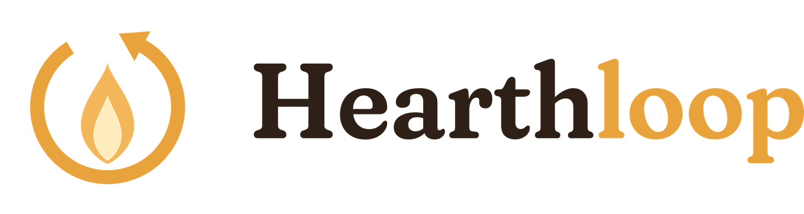
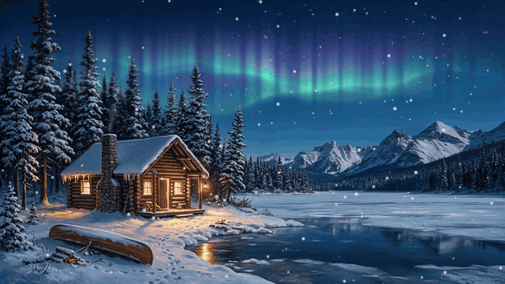
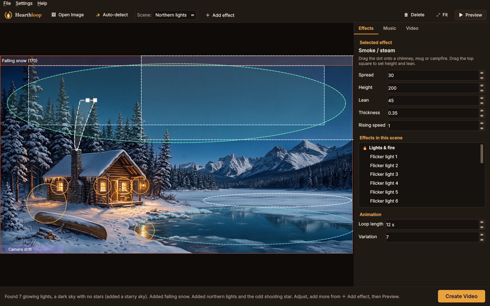
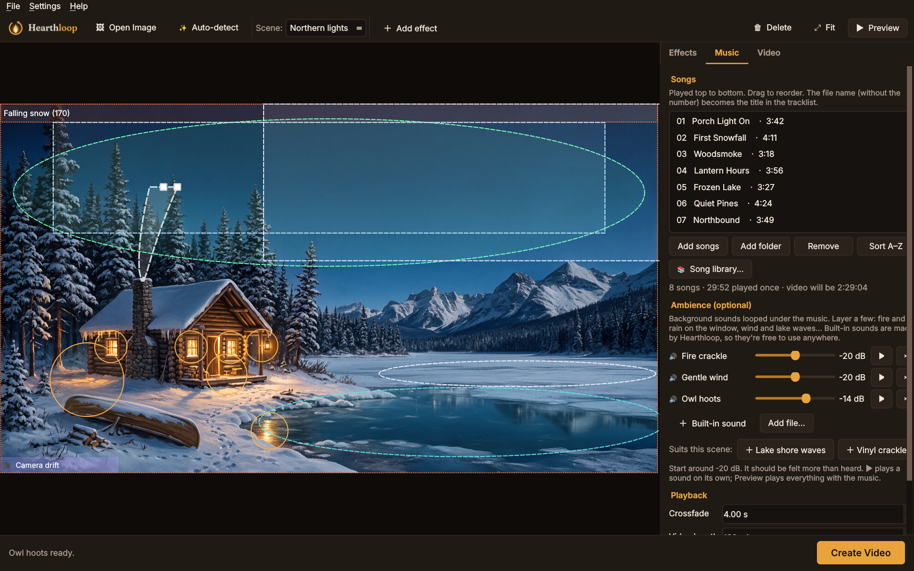

  <picture>
    <source media="(prefers-color-scheme: dark)" srcset="branding/hearthloop_logo_transparent_light-text.png">
    
  </picture>

  
  
  
  

<b>Turn a still scene and your songs into a long-form ambient music video.</b>

  <a href="https://skynrlabs.itch.io/hearthloop"><b>Download the free demo</b></a> &nbsp;·&nbsp;
  <a href="https://skynrlabs.itch.io/hearthloop"><b>Buy Hearthloop ($14.99)</b></a> &nbsp;·&nbsp;
  <a href="https://discord.gg/25mPUWUAa">Discord</a> &nbsp;·&nbsp;
  <a href="https://github.com/skynrlabs/Hearthloop/issues/new/choose">Report a bug</a>

## What is Hearthloop?

Open a background image of any season, drag a few effects onto it, add your songs, and click **Create Video**. Hearthloop animates the scene as a perfectly seamless loop, mixes the music with crossfades and layers of ambience, adds a "Now playing" title as each song starts, and writes a YouTube-ready tracklist with chapters.

It's built for cozy, café, cabin, lofi and jazz channels that publish one- and two-hour videos, and it turns hours of editing into a few clicks.

**30+ effects:** a crackling fire with rising embers, candle flames, flickering lamps, sunbeams with drifting dust, a spinning record, twinkling Christmas lights and stars, northern lights, a starry sky, lightning, shooting stars, a sweeping lighthouse beam, rolling fog, drifting clouds, chimney smoke, flowing and sparkling water, rain rings, bobbing boats, rain running down a window, falling leaves, snow, rain or petals, blowing leaves, blowing snow, diamond dust, swaying trees, a V of geese, fireflies, a waving flag, and a slow camera drift.

**Music and ambience:** a **Song library** that tags every song you make by theme and fills each new video's music in one click, plus built-in ambience (fire, rain, thunder, wind, waves, harbour water, birds, crickets, vinyl crackle and more) that's generated by Hearthloop, so there are no licences to worry about.

---

## 🛒 Getting Hearthloop

Hearthloop is a Windows app, sold on [itch.io](https://skynrlabs.itch.io/hearthloop).

- **$14.99 USD, one time.** No subscription, no watermark, no limits on video length.
- **Every Hearthloop 1.x update is free**, including new effects as they're added.
- **The videos you make are yours** to publish, monetise and sell. The built-in ambience sounds can be used in them with no credit or royalty.
- **Try it free first.** The free demo is the whole app: every effect, auto-detect, the music and ambience tools and unlimited previews. Finished demo videos stop at 10 minutes, go up to 1080p and have a small "Made with Hearthloop" watermark. Installing the full version over the demo keeps your projects, settings and song library.
- **All sales are final**, so please try the demo and check the requirements below before buying.

**System requirements:** Windows 10 or 11 (64-bit); 8 GB of RAM or more recommended; plenty of free disk space for renders (about 20 GB free is a safe amount for a 2-hour 1080p video); an internet connection once, the first time it runs, to download ffmpeg (about 100 MB).

## 📥 Installing

1. Download the installer (or the free demo) from [itch.io](https://skynrlabs.itch.io/hearthloop).
2. Run it and click through. No admin rights needed.
3. Open **Hearthloop** from the Start menu. The first time, it offers to download **ffmpeg** (the video engine, about 100 MB) from its official publisher. Already have ffmpeg? Choose **I have it...**.

> Windows may show **"Windows protected your PC"** because the installer isn't code-signed yet. Click **More info → Run anyway**.

To update, download and run the newer installer; your projects, settings and song library are kept.

---

## ⚙️ Using it

1. **Pick the scene type** in the toolbar: Autumn, Winter, Christmas, Northern lights, Rainy, Spring, Summer night or Other.
2. **Open Image.** Hearthloop auto-detects glowing lights (candles, lanterns, lamps), clusters of tiny lights (string lights, stars) and the moon. It then adds the season's leaves, snow, rain, petals or fireflies. If you change the scene type later, click **Auto-detect** to rescan.
3. **Adjust the effects** on the image. **＋ Add effect** has all of them:
   - **Flicker light**: drag it onto a candle, lantern or fireplace. Drag the white square, or scroll over it, to resize.
   - **Twinkle lights**: draw it around string lights or a starry sky. Every small bright point inside twinkles on its own.
   - **Smoke / steam**: drag the dot onto a chimney, mug or campfire. Drag the top square to set height and lean.
   - **Northern lights**: curtains of green and violet light ripple and sway across the sky, staying behind trees, mountains and rooftops. Choose the colours, number of curtains, ray height and movement.
   - **Water**: reflections wobble on a lake, river or puddle. **Flow** makes ripples drift for rivers and streams, and **Sparkle** adds glints of light on bright reflections like the moon or the aurora.
   - **Fireflies**: glowing dots wander and blink inside the area.
   - **Fireplace flames**: real moving flames for a hearth, wood stove or campfire. Drag the dot onto the logs, the top square for height and the side square for width. It also casts flickering firelight on the room around it.
   - **Embers**: sparks rise, flicker and fade above a fire. The top square sets how high they go and which way they drift.
   - **Rain on window**: beads of water sit on the glass and drops run down it, leaving trails. Each drop bends the view behind it like a little lens. **Misted glass** blurs the view between the drops. One per pane looks best.
   - **Bobbing boat**: a boat (or buoy, or float) rises, falls and rocks gently on the swell. Draw a box around each boat with the thick bottom edge on the waterline; each moves on its own timing. Add **Water** over the harbour so the ripples match.
   - **Rain rings**: raindrops land on water and make spreading rings. **Perspective** flattens them for water seen at a low angle.
   - **Starry sky**: adds new twinkling stars to a night sky, even one with no stars painted in. They stay behind trees, mountains and rooftops and off the moon. Mostly faint with a few bright ones; **Milky Way** adds a faint band of light across the sky. Auto-detect adds it when the sky is dark but has no stars.
   - **Lightning**: now and then the sky flashes in two or three quick flickers, lighting the clouds and the scene. **Bolt chance** sets how many flashes show a forked bolt, which strikes down through the box and stays behind hills and trees. Pair it with the **Distant thunder** sound and **Rain**.
   - **Shooting stars**: one now and then (set how many per loop), staying behind trees and mountains.
   - **Lighthouse beam**: a beam sweeps round from the lamp and flares as it swings toward you. Drag the dot onto the lamp and the square to set the reach and tilt. Looks great with fog.
   - **Sunbeams & dust**: soft shafts of light falling into a room from a window, gently brightening and fading, with dust drifting through them that only shows where it's lit. Put the top edge where the light comes in, set the **Angle** so the beams slant away from the window, and choose how many beams and how much dust.
   - **Candle flame**: a small, living flame. Drag the dot onto the wick and the top square to the flame's height. It sways, stretches and flickers, with a warm glow that also gently lights the room around it.
   - **Spinning record**: a record turns on a turntable. Fit the oval to the record (flatter when it's seen from the side), then drag the two squares onto the tonearm, one on its pivot and one on the needle, so the arm stays still. The label print and the glints on the grooves go round while the shine stays put, like a real record; the spindle stays still too. 33 rpm by default (45 for a single). It suggests the **Vinyl crackle** sound.
   - **Blowing leaves**: autumn leaves skitter, hop and tumble along the ground in gusts, then settle in the calm, with soft shadows under them. Draw it over a street or path; leaves near the bottom of the box are bigger and faster. Set the wind direction, gustiness and how much they hop. Drag any of its corners to follow a street going into the distance (the top edge is the far side); **Make it a rectangle again** squares it back up. When the scene has **Glass panes**, blowing leaves show only through the glass, and they never cover a **Keep clear** area.
   - **Blowing snow**: snow whips along the ground or off a roof. Set the wind direction and strength.
   - **Swaying trees**: draw the box around trees or grass. The bottom edge stays put and the tops sway, with optional leaf flutter.
   - **Diamond dust**: tiny ice crystals drift and glint in cold air.
   - **Geese**: a V of geese flies across the box now and then. **Crossing time** sets how long a pass takes; make it longer than the loop length to keep them in view the whole time.
   - **Camera drift**: a slow push-in and gentle drift over the whole picture, with optional film grain and vignette. Select it from the strip at the bottom left; the dotted frame shows the tightest crop. Keep the grain low for YouTube, since grain costs bitrate.
   - **Fog**: rolls and drifts inside the ellipse. Keep it off foreground objects.
   - **Clouds**: drift across the ellipse and pass *behind* trees and branches. Choose the **Look**: **Fluffy** (puffy clouds lit from above, so they catch the moon or sun) or **Wispy** (thin streaks). **Cloud cover** sets how much of the sky they fill.
   - **Falling leaves / snow / rain / petals**: one falling effect per scene; switch its **Type** in the panel. Drag the label strip to move it. **Wind** blows it sideways. Drag any of its four corners to tilt or stretch it, like a glass pane (the edge handles resize it while it's still a rectangle); **Make it a rectangle again** squares it back up. For a view **through a window** (a café or cabin looking out), draw the box over the window and tick **Only through the glass**: the leaves or snow then pass behind the window frame and glazing bars, as if they're really outside. Anything bright inside the room that sits in front of the window (a lamp, a plant, ceiling lights) can still catch a leaf, so draw a **Keep clear** box over it: the falling effect never covers a Keep clear area. For a perfect result, add a **Glass pane** for each pane of the window and drag its 4 corners onto the corners of the glass: when a scene has glass panes, the falling effect shows only inside them.
   - **Waving flag**: a drawn Canadian flag. Drag the dot onto the post and the white square to aim the pole.
   - **Flag ripple**: for a flag that's *already in the picture*. Drag the 4 corners onto it, with the thick edge where it meets the pole.
   - **Resizing:** select an effect and drag the white squares on its edges or corners. Hold **Shift** to keep proportions, **Alt** to resize from the centre. The falling effect can cover the whole picture or just part of it (only around a tree, say, or only the sky). Things fade in and out at its edges.
   - Fine-tune anything in the **Effects** panel. **Del** removes the selected effect. **Ctrl+scroll** zooms.
4. **▶ Preview** plays a quick low-res version of the loop with your music and ambience. Pick which song plays, and drag the **Ambience** slider to turn all the ambience layers up or down together by ear (it updates the Music tab too).
5. **Music tab.** Add songs (or a whole folder) and drag them into order. Or use the **📚 Song library**: add every song you make once (a whole Suno batch at a time), tag them by theme (Café, Winter cabin, Harbour...), then for each new video pick a theme and how many minutes of music, and click **Pick songs**. It puts never-used songs first, leaves out songs from your last few videos, and shuffles the order. Each finished video is noted against the songs it used, so you can see what's been used where. If the **Video length** is longer than the songs, they repeat, and the tracklist shows each song once, then "Second set", "Third set"... Under **Ambience**, layer as many background sounds as you like, each with its own level:
   - **＋ Built-in sound** adds one that Hearthloop makes itself (fire crackle, light or heavy rain, rain on window, distant thunder, gentle or strong wind, lake shore waves, harbour water, distant foghorn, buoy bell, creaking dock and ropes, distant train horn, morning birds, spring peepers, owl hoots, wind chimes, summer crickets, quiet room, clock ticking, vinyl crackle). They're generated in code, so there are no licences to worry about, and they loop seamlessly. Each is made once, the first time you use it.
   - **Suits this scene** suggests sounds that match your effects: fire crackle for fireplace flames, rain on window for window rain, wind for blowing snow, crickets for fireflies, birds for spring scenes, a foghorn, harbour water, a buoy bell and creaking ropes for a lighthouse, thunder for lightning, peepers for spring, an owl for starry nights, wind chimes for a lit porch, and vinyl crackle for any scene.
   - **Add file...** adds your own recording (loons, a real fireplace...). Use ones you're allowed to use on YouTube, such as the YouTube Audio Library or Pixabay.
   - **▶** plays a single sound on its own.

   Use **Video length** to repeat the songs until the video is, say, 60 or 120 minutes, and tick **Shuffle** so repeats come in a new order.
6. **Video tab.** Name it, choose where to save, and pick a resolution. **Like & subscribe reminder** adds a small like, subscribe and bell animation that plays once near the start (30 seconds in by default) and fades away; it's not part of the loop, so it never repeats. Choose when and where it appears, and click **▶ Show me** to see it. **Now playing titles** fade in each song's title (from the Music tab) a couple of seconds after it starts and fade it away again; set how long they stay up and where they sit, and **▶ Show me** previews one. Only the few seconds around each title are re-rendered, so long videos still build quickly.
7. **Create Video.**

You can drop images, songs or folders anywhere on the window. **File → Save project** keeps everything as a `.hloop` file for next time. **File → Batch render** queues several saved projects and renders them one after another, which is handy overnight.

### 📁 What you get

A folder named after the video containing:

| File | What it is |
|---|---|
| `name.mp4` | The finished video to upload |
| `name_loop.mp4` | The animated loop on its own (reusable) |
| `tracklist.txt` | Timestamps; paste into the YouTube description for chapters (repeats show as "Second set") |
| `description.txt` | Your YouTube title plus the tracklist |
| `thumbnail.jpg` | A full-resolution frame to start your thumbnail from |

Song titles come from each file's title tag, or from the file name with leading numbers removed (`01 - Porch Light On.wav` becomes "Porch Light On").

---

## 🩺 Troubleshooting

| Problem | Fix |
|---|---|
| **"Windows protected your PC"** when installing | The installer isn't code-signed yet. Click **More info → Run anyway**. |
| ffmpeg won't download | Check your internet connection and try **Settings → Download ffmpeg...** again, or install it yourself (`winget install Gyan.FFmpeg`) and choose **Settings → Set ffmpeg folder**. |
| Rendering stops partway | Usually free disk space: a 2-hour 1080p video needs about 20 GB free while it renders. |
| Falling leaves or snow show up inside the room | Add a **Glass pane** for each pane of the window and drag its 4 corners onto the glass. With glass panes, the falling effect shows only through them. Draw a **Keep clear** box over lamps or plants in front of the window. |
| The demo video stops at 10 minutes | That's the demo's limit. The [full version](https://skynrlabs.itch.io/hearthloop) has no length limit, no watermark and goes up to 4K. |

Still stuck? Ask in [#help on Discord](https://discord.gg/25mPUWUAa) or [open an issue](https://github.com/skynrlabs/Hearthloop/issues/new/choose).

## 🐞 Bugs and ideas

Found a bug, or have an idea for a new effect? [Open an issue](https://github.com/skynrlabs/Hearthloop/issues/new/choose). This repo is where Hearthloop is supported; the source code itself is private.

## 💬 Community

Join the [Skynr Labs Discord](https://discord.gg/25mPUWUAa) to ask questions, share the videos you've made and hear about new effects first. It's one server for all the Skynr Labs apps: Hearthloop, WavMasta, Stemquill and SemaBuzz.

## 📄 Licence

Hearthloop is proprietary software. © 2026 Skynr Labs. All rights reserved.

It's sold under the end-user licence in [`LICENSE`](LICENSE) (also shown in **Help → Licences**). In short, you may install and use Hearthloop for personal or commercial work, and everything you make with it (videos, thumbnails, tracklists) is yours to publish, monetise and sell; the built-in ambience sounds can be used in them without credit or royalty. You may not copy, share or resell Hearthloop, or reverse-engineer it.

Third-party components keep their own licences; see [`THIRD_PARTY.txt`](THIRD_PARTY.txt). ffmpeg isn't included with Hearthloop: your copy is downloaded from its publisher on first run, under its own licence (GNU GPL v3).

---

Made by <a href="https://github.com/skynrlabs">Skynr Labs</a> in Ontario, Canada &nbsp;·&nbsp; <a href="https://skynrlabs.itch.io/hearthloop">itch.io</a> &nbsp;·&nbsp; <a href="https://discord.gg/25mPUWUAa">Discord</a>

